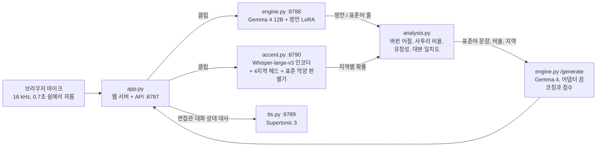

# 서투리: 사투리 음성 코칭 서비스

[English](README.md) | 한국어

면접·발표·일상 대화에서 표준어를 연습하려는 지역 방언 화자를 위한 AI 코칭 서비스입니다.
**AI Hub 방언 음성으로 미세조정한 Gemma 4 12B가 문장마다 직접 듣고, 들은 그대로의 문장과 같은 뜻의 표준어 문장을 함께 씁니다. 따로 학습한 억양 분류기(Whisper-large-v3 인코더 기반)는 모든 단어가 표준어여도 목소리만으로 어느 지역 억양인지 판별합니다.**
웹 앱은 이 두 결과로 교정, 사투리 비율, 면접 점수, 말로 대화하는 연습 상대, 복습을 제공합니다.

> 팀 말버스: 이재석, 이소윤, 이혜린, 전상현
> 이 저장소에는 NVIDIA DGX Spark(GB10)에서 만들고 운영한 음성 모델과 실제 동작하는 웹 서비스가 들어 있습니다. 서비스 화면은 팀의 포스터와 최종 발표 자료를 따랐습니다. 팀의 초기 시제품(Streamlit, Qwen3·Gemma 3)은 [LEEJAESEOK212/seotturi](https://github.com/LEEJAESEOK212/seotturi)에 있습니다.

모델은 문장마다 두 줄로 답합니다. 예를 들면:

```text
방언: 니 밥 뭇나?        ← 들은 그대로
표준어: 너 밥 먹었어?     ← 같은 문장의 표준어
```

여기에 억양 분류기가 목소리에서 들린 지역(이 예에서는 부산·울산·경남)을 더합니다.

## 핵심 결과

### 1. 방언 음성 → 받아쓰기와 표준어 변환 (Gemma 4 12B + LoRA)

서비스 중인 어댑터(`lora_s6c`)를 독립 시험 세트로 평가했습니다. AI Hub 검증(Validation) 분할의 4,000문장(지역당 1,000문장, 5.0시간)이며, 학습·검증 세트·사이트 벤치마크에 쓴 녹음과 겹치지 않습니다. 디코딩은 사이트와 같습니다. 지표는 코퍼스 문자 오류율(CER, 띄어쓰기·문장부호 제외, 낮을수록 좋음)이고, 괄호는 녹음 단위 부트스트랩 95% 구간입니다.

| 지역 | 방언 줄 (들은 그대로) | 표준어 줄 |
| --- | ---: | ---: |
| 강원 | 0.151 [0.136–0.170] | 0.156 [0.140–0.175] |
| 경상 | 0.071 [0.066–0.077] | 0.074 [0.068–0.079] |
| 제주 | 0.295 [0.276–0.313] | 0.322 [0.302–0.341] |
| 충청 | 0.096 [0.088–0.103] | 0.095 [0.087–0.102] |
| **전체** | **0.140 [0.133–0.147]** | **0.147 [0.139–0.154]** |

미세조정 전후 비교는 검증 세트 1,199문장에서 했습니다(2단계 어댑터 `lora_v1`, 문장별 CER 평균, 일반 디코딩).

| 지역 | 방언 CER 학습 전 → 후 | 표준어 CER 학습 전 → 후 |
| --- | ---: | ---: |
| 강원 | 0.426 → 0.216 | 0.514 → 0.188 |
| 경상 | 0.242 → 0.129 | 0.364 → 0.100 |
| 제주 | 0.860 → 0.425 | 0.873 → 0.424 |
| 충청 | 0.293 → 0.132 | 0.383 → 0.126 |
| **전체** | **0.455 → 0.225** | **0.534 → 0.209** |

- 서비스 모델을 바꿀 때마다 새 어댑터가 이 시험 세트에서 이전 어댑터를 이겼습니다(녹음 단위 짝지은 부트스트랩). `lora_v1` → `lora_r64c` → `lora_s6c`로 방언 CER은 0.147 → 0.145 → 0.140, 표준어 CER은 0.153 → 0.151 → 0.147이 됐습니다(더 나을 확률 0.98 / 0.96, 그다음 1.00 / 1.00).
- 남은 오류(`lora_s6c`)는 문장 가운데 일반 단어에서 52%, 첫·끝 단어에서 34%, 사투리 단어에서 11%가 나옵니다. 변환 자체는 거의 풀렸습니다. 방언 줄이 맞으면 표준어 줄의 CER은 0.012입니다.
- 가장 약한 지역은 제주입니다. 시험 클립의 58%가 3초 미만이고(그 구간 CER 0.366), 55%가 말 도중에 시작하거나 끝납니다. 다만 깔끔하게 잘린 클립도 0.269이고, 자르는 구간을 넓히면 오히려 나빠졌습니다.

### 2. 목소리로 억양 지역 판별 (Whisper-large-v3 인코더 + 분류 헤드)

서비스 중인 억양 시스템을 앱에서 쓰는 방식 그대로 답변 단위로 평가했습니다. AI Hub 검증 분할의 화자(지역 세트마다 250명, 서울·경기 화자는 있는 100명 전부)가 **사투리 단어가 없는** 문장 1~8개로 답하므로, 억양만으로 지역을 구분해야 합니다. 음성은 사이트와 같은 전처리를 거쳤습니다.

| 답변 문장 수 | 말소리 길이(중앙값) | 4지역 Macro-F1 [95% CI] | 표준·지역 구분 AUC | 지역 억양으로 판정된 서울·경기 화자 |
| ---: | ---: | ---: | ---: | ---: |
| 1 | 3.6초 | 0.832 [0.808–0.854] | 0.901 | 24% |
| 2 | 7.7초 | 0.859 [0.837–0.880] | 0.915 | 24% |
| 4 | 15.7초 | 0.898 [0.878–0.916] | 0.934 | 23% |
| 8 | 31.5초 | 0.911 [0.892–0.928] | 0.942 | 26% |

- 3단계에서 학습한 Gemma의 `지역:` 줄은 주로 단어로 지역을 맞혀서, 사투리 단어가 없는 말에서는 Macro-F1 0.216(7개 권역)에 그쳤습니다. 그래서 앱은 지역을 이 분류기에서 가져옵니다.
- 브라우저는 잡음을 줄이면서 단어 사이를 거의 무음으로 만들고, 이것이 첫 분류기를 무너뜨렸습니다. 학습 클립마다 녹음 환경을 바꾼 복사본 2개(단어 사이 무음화, 잡음 제거, 마이크 EQ, Opus 압축, 다른 세트의 배경, 음량)를 더해 학습하자, 4지역 균형 재현율이 무음화 조건에서 0.537 → 0.792, 학습 때 쓰지 않은 잡음 제거기 조건에서 0.625 → 0.715로 올랐습니다.

## 동작 방식



1. **녹음**: 브라우저가 0.7초 쉼에서 녹음을 자르고(모델이 1~20초 발화로 학습했으므로 클립당 최대 15초), 쉴 때마다 바로 보냅니다. 그래서 사용자가 말하는 동안 앞 문장의 받아쓰기가 이미 시작됩니다.
2. **받아쓰기와 변환**: 엔진은 Gemma 4 12B와 방언 LoRA를 GPU에 올려 둡니다. Gemma 4 12B에는 별도의 음성 인코더가 없고, 원시 파형을 40ms 조각으로 투영층 하나에 통과시켜 바로 받습니다. 그래서 모든 층에 붙인 LoRA와 그 투영층이 곧 음향 모델입니다. 사이트 디코딩은 답이 `방언:`으로 시작하게 하고, 토큰 예산을 클립 길이에 맞추며, 같은 조각이 8번 반복되면 멈춥니다(2번만 남기고 표준어 줄을 다시 생성).
3. **억양**: 고정한 Whisper-large-v3 인코더의 은닉 상태 33개를 말소리 구간에서 평균 냅니다. 4지역 헤드(강원·충청·경상·제주)는 P(지역 | 지역 억양)을, 따로 둔 판별기는 P(서울·경기)를 냅니다. 앱은 한 답변의 클립을 길이로 가중 평균하고, 답변이 지역 억양으로 들리면 그 억양을 사투리 비율에 반영합니다.
4. **점수**: 사투리 비율은 모델이 바꾼 어절과 지역 억양이 실린 어절의 비율이고, 표준어 점수는 100에서 그 비율을 뺀 값입니다. 유창성(말 속도, 발성 비율, 평균 발화 길이, 군말)은 녹음에서 직접 재고, 발표에서는 대본 일치도를 문장별 BERTScore 재현율과 글자 바이그램 재현율 중 큰 값으로 계산합니다. 면접 점수 = 표준어 점수 + 답변 점수(200점 만점, 140점 합격)입니다. 전체 규칙은 [docs/seotturi_judgment_logic.pdf](docs/seotturi_judgment_logic.pdf)에 정리했습니다.
5. **코칭**: 같은 Gemma 4를 어댑터를 끈 채로 써서, 표준어 문장·사투리 비율·지역(음성은 주지 않음)을 읽고 피드백을 씁니다. 기준표 점수는 점수 토큰 확률의 기댓값(G-Eval)으로 매깁니다.
6. **대화 상대**: 면접관 5명, 청중 3종, 일상 상황별 등장인물이 Supertonic 3(CPU)로 대사를 말합니다. 장면 그림은 앱의 캐릭터 이미지를 바탕으로 Qwen-Image-Edit-2511로 그렸고([img-gen/](img-gen/)), 캐릭터는 눈을 깜빡이고 말할 때 입을 움직입니다.
7. **모델 업데이트**: 엔진은 새 체크포인트를 고정 벤치마크(사투리 160문장 + 일반 105문장)로 채점하고, 짝지은 부트스트랩에서 더 나을 확률이 0.95 이상일 때만 재시작 없이 약 1.5초 만에 어댑터를 바꿉니다. 결과는 사이트의 `/benchmark` 페이지에 나옵니다.

## 학습 단계

각 단계는 그때 서비스 중이던 어댑터에서 시작했고, 검증에 쓰지 않은 데이터에서 이겼을 때만 채택했습니다. 멈춘 단계의 스크립트도 시도한 내용을 보여 주려고 남겼습니다.

| 단계 | 어댑터 | 학습 데이터 | 설정 | 결과 |
| --- | --- | --- | --- | --- |
| 1 | `lora_gangwon` | 강원 25,000 | 모든 어텐션·MLP 층에 LoRA r16 + 오디오 투영층, lr 1e-4, 1 epoch | 강원 CER 0.426 / 0.514 → 0.208 / 0.202 |
| 2 | `lora_v1` | 경상·제주·충청 각 25,000 추가, 강원 10% 재학습(82,477) | 1단계에서 이어 학습 | 전 지역 0.455 / 0.534 → 0.225 / 0.209 |
| 3 | `lora_v2`, `lora_v2r` | 새 발화 50만; 이어서 답 앞에 `지역:` 줄 | v1에서 이어 학습 | 중단(4,949·6,500스텝): 벤치마크에서 v1보다 낫지 않음 |
| 4 | `lora_v3` | 64,000, 제주 40% | v1에서, lr 2e-5 | 중단: 검증 세트의 제주 개선이 독립 시험 세트에서는 사라짐 |
| 5 | `lora_r64` → `lora_r64c` | 새 발화 48,000 | v1을 가중치에 합친 뒤 rank-64 LoRA, lr 2e-5; v1과 합쳐 rank-80 어댑터 하나로 | 시험 0.147 / 0.153 → 0.145 / 0.151 |
| 6 | `lora_s6` → `lora_s6c` | 새 발화 64,000 | r64c 위에 rank-64 LoRA, rank-144 어댑터 하나로 합침 | 시험 0.145 / 0.151 → **0.140 / 0.147**, 2026-10-11부터 서비스 |
| 7 | `lora_s7` | 308,363 | s6c 위에 rank-128 LoRA | 준비 후 첫 스텝 전에 중지 |

CER은 방언 줄 / 표준어 줄입니다. 한 스텝은 16발화(2 × 누적 8, GB10에서 가장 빠른 조합)로 약 11~13초, 최대 메모리 31~34GB였습니다. 자세한 내용과 오류 분석, 억양(의문문) 시험은 [gemma4-dialect/README.md](gemma4-dialect/README.md)에, 억양 분류기 실험은 [accent-id/README.md](accent-id/README.md)에 있습니다(영어).

## 저장소 구조

```text
seotturi/
├── gemma4-dialect/           # Gemma 4 12B 방언 음성 LoRA
│   ├── common.py             #   프롬프트, 오디오 읽기, 배치, 답 해석, CER (웹 엔진도 가져다 씀)
│   ├── prepare_data.py       #   AI Hub 표본 추출과 발화 자르기 → 목록 파일
│   ├── prepare_origin.py     #   출생지·거주지로 화자 억양 권역 붙이기 (3단계)
│   ├── train.py              #   LoRA 학습: 이어 하기, --init-adapter, --merge-adapter
│   ├── evaluate.py           #   채점, --guard = 사이트 디코딩
│   ├── score_eval.py         #   코퍼스 CER, 자모 CER, 녹음 단위 부트스트랩, 더 나을 확률
│   ├── combine_adapters.py   #   겹쳐 학습한 LoRA를 서비스용 어댑터 하나로 합침
│   ├── error_analysis.py     #   원인·지역·클립 길이·라벨 확인별 CER
│   ├── prepare_intonation.py, score_intonation.py   # 억양(의문문) 시험 세트와 채점
│   ├── run_stage*.sh         #   1~7단계 (keep_stage*.sh는 죽으면 다시 시작)
│   ├── run_eval_*.sh         #   검증·시험·클립 여유 실험 평가
│   ├── *_jeolla.py           #   전라 정렬 파일럿 (쓰지 않음: Whisper 정렬이 원본 파일 하나에 약 16시간)
│   └── results/              #   runs/에서 옮긴 보고서와 학습 설정
├── accent-id/                # 고정 Whisper-large-v3 인코더 위 억양 권역 분류기
│   ├── common.py             #   권역, 인코더 특징, 헤드, Classifier·Tree (억양 서비스가 가져다 씀)
│   ├── prepare.py, features.py, train_head.py   # 분할, 풀링 특징, 1단계 헤드
│   ├── finetune.py, finetune3.py                # 2·3단계: 인코더 위쪽 층 LoRA
│   ├── region4.py, augment.py, conditions.py    # 4지역, 녹음 환경 복사본, 조건별 시험
│   ├── calibrate_std.py, session_eval.py        # 표준 억양 판별 보정, 답변 단위 평가
│   └── results/              #   모든 실험의 지표, 조건별 시험, 답변 단위 보고서
├── seotturi-web/             # 서비스
│   ├── run.sh                #   서버 4개 시작·중지·재시작
│   ├── server/               #   engine.py, accent.py, tts.py, app.py, analysis.py, pron.py
│   ├── web/                  #   소개 페이지, 앱(휴대폰 화면), /benchmark, /record 녹음 시험 페이지
│   └── scripts/              #   벤치마크 세트와 지표, 단어 도감, 정적 사본, 캐릭터 프레임
├── img-gen/                  # 대화 상대 장면 그림 (Qwen-Image-Edit-2511)
├── docs/                     # 판정 로직(PDF + HTML 원본), 방언·억양 통합 모델 논문 조사
└── requirements.txt
```

## 실행 방법

### 0. 환경과 경로

NVIDIA DGX Spark(GB10, aarch64, 통합 메모리 128GB), Python 3.13, CUDA에서 확인했습니다. 스크립트는 그 장비의 절대 경로를 그대로 씁니다. 저장소는 `/data/seotturi`, AI Hub 원본은 `/data/aihub/<데이터셋 번호>/`, Hugging Face 캐시는 `/data/huggingface`, 가상환경은 `/data/seotturi/.venv`입니다. 같은 위치에 받거나 이 경로들을 링크로 만들어 주세요.

```bash
git clone https://github.com/sangj-03/Seotturi.git /data/seotturi
cd /data/seotturi
python3 -m venv .venv && .venv/bin/pip install -r requirements.txt   # torch는 CUDA 판을 먼저 설치
python3 -m venv seotturi-web/.venv-tts && seotturi-web/.venv-tts/bin/pip install -r seotturi-web/requirements-tts.txt
```

필요한 모델(Hugging Face): `google/gemma-4-12B-it`(스냅샷 경로는 `gemma4-dialect/common.py`의 `MODEL_PATH`), `openai/whisper-large-v3`, `Supertone/supertonic-3`(`/data/seotturi/models/supertonic3`에), 사이트의 추가 검사용 `slplab/wav2vec2-xls-r-300m_phone-mfa_korean`, `klue/roberta-base`.

### 1. 데이터

[AI Hub](https://aihub.or.kr)에서 한국어 방언 발화(강원도 118, 경상도 119, 제주도 121, 충청도 122)를 신청해 `/data/aihub/<번호>/`에 받습니다(ARM64에서는 AI Hub의 `aihubshell` 사용). `prepare_data.py`가 압축된 음성(WAV 또는 FLAC)과 라벨 JSON을 읽어 발화를 잘라 냅니다. 전라(120)는 라벨이 시각 없는 텍스트뿐이라 쓰지 않았습니다.

### 2. Gemma 4 어댑터 학습·평가

```bash
cd /data/seotturi/gemma4-dialect && mkdir -p runs
setsid nohup ./run_stage1_gangwon.sh > runs/stage1.log 2>&1 < /dev/null &   # 강원, 약 5시간
setsid nohup ./run_stage2_all.sh > runs/stage2.log 2>&1 < /dev/null &       # 1단계를 기다렸다가 4개 지역, 약 15시간
```

결과가 이미 있는 단계는 건너뛰고, 학습은 가장 최근 체크포인트에서 이어 합니다. 뒤 단계(`run_stage5_r64.sh`, `run_stage6.sh`)는 이전 어댑터 위에서 학습하고 시험 세트 보고서까지 만듭니다. `keep_stage*.sh`는 학습이 죽으면 다시 시작합니다.

### 3. 억양 분류기 학습

```bash
cd /data/seotturi/accent-id
PY=/data/seotturi/.venv/bin/python; export HF_HOME=/data/huggingface HF_HUB_OFFLINE=1
$PY prepare.py index && $PY prepare.py split                         # 2단계에서 자른 클립, 녹음 단위 분할
$PY features.py train dev test_plain test_same test_dialect bench    # 인코더 풀링 특징 (약 1시간)
$PY train_head.py --out runs/phase1                                  # 1단계 헤드와 시험 점수
```

서비스 중인 두 모델은 이 특징 위에 만듭니다. 4지역 헤드 `runs/region4`(`region4.py`, `features.py r4_aug r4_dev_aug`, `run_region4.sh`)와 표준 억양 판별기 `runs/detector_mix`이고, 서비스는 `runs/served`, `runs/served_std` 링크로 읽습니다. 모든 실험의 순서는 [accent-id/README.md](accent-id/README.md)에 있습니다.

### 4. 서비스 실행

```bash
cd /data/seotturi/seotturi-web
./run.sh start     # Gemma 엔진(불러오는 데 약 5분), TTS, 억양 서비스, 웹 서버
./run.sh status    # 서비스 중인 어댑터, 벤치마크 점수, 다음 업데이트 확인 시각
```

http://localhost:8787 (휴대폰 틀 안에 앱이 있는 소개 페이지) 또는 http://localhost:8787/app 으로 접속합니다. 브라우저는 `localhost`나 HTTPS에서만 마이크를 허용합니다. 엔진은 `SEOTTURI_WATCH`에 적힌 어댑터를 씁니다(기본값 `lora_r64c:basic,lora_s6c:basic`). 학습과 메모리를 함께 쓰는 장비라면 데스크톱 터미널 대신 cron에서 서버를 켜세요. 메모리가 부족해지면 systemd-oomd가 터미널 범위(scope)를 통째로 종료합니다.

### 5. GPU 없이 결과 보기

`results/` 폴더는 `runs/`의 보고서 파일을 옮겨 둔 것입니다.

```bash
cat gemma4-dialect/results/eval_test_guard/report_s6c.txt        # 서비스 어댑터, 시험 세트 4,000문장
cat gemma4-dialect/results/eval_test_guard/s6c/error_analysis.md # 오류가 어디서 나오는지
cat accent-id/results/session_eval/report.md                     # 답변 단위 억양 판정
```

## 포함하지 않은 것

- **AI Hub 데이터**: 음성, 잘라 낸 클립, 목록 파일, 모델 예측 결과. AI Hub 이용 약관상 재배포할 수 없습니다. 단어 도감(`seotturi-web/scripts/build_dict.py`)도 이 데이터와 우리말샘(`fetch_opendict.py`, 본인 API 키 필요)으로 만들기 때문에 넣지 않았습니다.
- **학습한 가중치**: LoRA 어댑터, 분류 헤드, 인코더 특징 캐시.
- **서비스 상태**: 앱 데이터베이스, `/record` 녹음 시험 페이지의 녹음, 로그, `scripts/build_static.py`로 만든 정적 사본.
- **내려받는 모델**: Gemma 4 12B, Whisper-large-v3, Supertonic 3, Qwen-Image-Edit-2511, `img-gen/faces.py`가 쓰는 YuNet 얼굴 검출기.

## 알려진 한계

- 제주는 다른 지역보다 크게 뒤처집니다(CER 약 0.30, 다른 지역 0.07~0.16). 오류 분석을 보면 CER 한 자리를 위해서는 사투리 어휘보다 일반 단어 인식, 특히 짧은 클립의 인식을 높여야 합니다.
- 전라는 두 모델 모두 다루지 않습니다.
- 억양 정답은 클립이 녹음된 AI Hub 세트이고, 세트마다 녹음 환경이 다릅니다. 배경만 들려줘도 균형 재현율 0.50(우연 0.25)으로 지역을 맞히고, 답변 단위에서 서울·경기 화자의 23~26%를 지역 억양으로 판정합니다. 기준값은 실제 브라우저 녹음(`/record`, `accent-id/eval_browser.py`)으로 정해야 하는데, 아직 모으지 못했습니다.
- AI Hub는 녹음 안에서만 화자 번호를 매기므로 녹음 단위로 나눴고, 같은 사람이 다른 번호로 학습과 시험에 함께 있을 수 있습니다. 목소리 유사도로 확인한 결과 시험 정확도는 이런 겹침에 좌우되지 않았습니다.
- 검증 세트 1,199문장은 체크포인트 선택에도 썼고, 독립 시험 세트도 어댑터 결정에 여러 번 썼습니다.
- 경로가 절대 경로이고(실행 방법 참고), 서비스는 엔진·억양 서비스·학습이 GPU 하나를 함께 쓴다고 가정합니다.

## 참고

- 모델: [Gemma 4](https://huggingface.co/google/gemma-4-12B-it), [Whisper-large-v3](https://huggingface.co/openai/whisper-large-v3), [Supertonic 3](https://huggingface.co/Supertone/supertonic-3) (OpenRAIL-M), [Qwen-Image-Edit-2511](https://huggingface.co/Qwen/Qwen-Image-Edit-2511) (Apache-2.0)과 [Lightning LoRA](https://huggingface.co/lightx2v/Qwen-Image-Edit-2511-Lightning), [wav2vec2 한국어 음소 모델](https://huggingface.co/slplab/wav2vec2-xls-r-300m_phone-mfa_korean), [klue/roberta-base](https://huggingface.co/klue/roberta-base), [PEFT](https://github.com/huggingface/peft). 글꼴: [Pretendard](https://github.com/orioncactus/pretendard) (SIL OFL 1.1).
- 데이터: AI Hub 한국어 방언 발화(강원도·경상도·제주도·충청도), 단어 도감에 국립국어원 [우리말샘](https://opendict.korean.go.kr) (CC BY-SA 2.0 KR).
- 각 모델과 데이터는 각자의 라이선스를 따릅니다.
