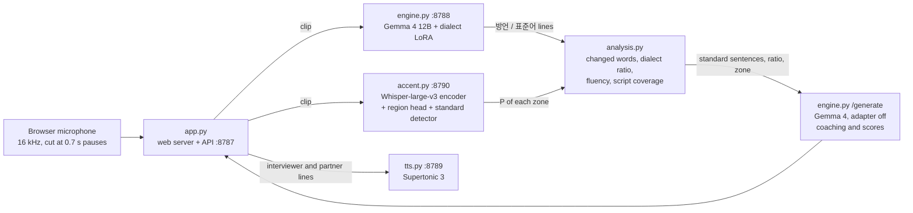

# 서투리 (Seotturi): Korean Dialect Speech Coach

English | [한국어](README.ko.md)

An AI coach for speakers of Korean regional dialects who want to practise standard Korean for interviews, presentations and everyday conversation.
**A Gemma 4 12B model fine-tuned on AI Hub dialect speech hears each sentence and writes down both what was said and the same sentence in standard Korean. A separate accent classifier on the Whisper-large-v3 encoder tells from the voice which region the accent comes from, also when every word is standard.**
The web app turns both into corrections, a dialect ratio, interview scores, spoken conversation partners and review.

> Team 말버스 (Malbus): 이재석, 이소윤, 이혜린, 전상현
> This repository holds the speech models and the working web service, built and run on an NVIDIA DGX Spark (GB10). The service follows the team's poster and final deck. The team's earlier prototype (Streamlit, Qwen3 and Gemma 3) is at [LEEJAESEOK212/seotturi](https://github.com/LEEJAESEOK212/seotturi).

For each sentence the model answers in two lines, for example:

```text
방언: 니 밥 뭇나?        ← what was said, as spoken
표준어: 너 밥 먹었어?     ← the same sentence in standard Korean
```

and the accent classifier adds the zone heard in the voice (here 부산·울산·경남).

## Key results

### 1. Dialect speech → transcript and standard Korean (Gemma 4 12B + LoRA)

The served adapter (`lora_s6c`) on an independent test set: 4,000 utterances (1,000 per region, 5.0 h) from AI Hub's Validation split, taken from recordings used neither for training nor for the validation set or the site's benchmark. Decoding is the same as on the site. Corpus character error rate (CER, spaces and punctuation removed; lower is better), with 95% intervals from a bootstrap over recordings:

| Region | Dialect line (as spoken) | Standard-Korean line |
| --- | ---: | ---: |
| 강원 Gangwon | 0.151 [0.136–0.170] | 0.156 [0.140–0.175] |
| 경상 Gyeongsang | 0.071 [0.066–0.077] | 0.074 [0.068–0.079] |
| 제주 Jeju | 0.295 [0.276–0.313] | 0.322 [0.302–0.341] |
| 충청 Chungcheong | 0.096 [0.088–0.103] | 0.095 [0.087–0.102] |
| **All** | **0.140 [0.133–0.147]** | **0.147 [0.139–0.154]** |

What fine-tuning changed, on the 1,199 held-out validation utterances (stage 2 adapter `lora_v1`; mean CER per utterance, plain decoding):

| Region | Dialect CER, base → tuned | Standard CER, base → tuned |
| --- | ---: | ---: |
| 강원 | 0.426 → 0.216 | 0.514 → 0.188 |
| 경상 | 0.242 → 0.129 | 0.364 → 0.100 |
| 제주 | 0.860 → 0.425 | 0.873 → 0.424 |
| 충청 | 0.293 → 0.132 | 0.383 → 0.126 |
| **All** | **0.455 → 0.225** | **0.534 → 0.209** |

- Each served adapter beat the one before it on this test set in a paired bootstrap over recordings: `lora_v1` → `lora_r64c` → `lora_s6c` lowered the dialect CER 0.147 → 0.145 → 0.140 and the standard CER 0.153 → 0.151 → 0.147 (probability of being better 0.98 / 0.96, then 1.00 / 1.00).
- Where the remaining errors are (`lora_s6c`): ordinary words in the middle of a sentence cause 52% of them, the first and last word 34%, dialect words 11%. The conversion itself is nearly solved: when the dialect line is right, the standard line has a CER of 0.012.
- Jeju is the weakest region. 58% of its test clips are shorter than 3 s (CER 0.366 there). 55% start or end inside speech, but clips cut cleanly are still at 0.269, and widening the cuts made the transcripts worse.

### 2. Accent zone from the voice (Whisper-large-v3 encoder + heads)

The served accent system scored on whole answers, as the app uses it: speakers from AI Hub's Validation split (250 per regional set and all 100 Seoul-Gyeonggi speakers there) answer with 1 to 8 sentences **without dialect words**, so only the accent tells the regions apart. Audio is prepared as on the site.

| Sentences per answer | Speech (median) | Four-region macro-F1 [95% CI] | Standard vs regional AUC | Seoul-Gyeonggi speakers called regional |
| ---: | ---: | ---: | ---: | ---: |
| 1 | 3.6 s | 0.832 [0.808–0.854] | 0.901 | 24% |
| 2 | 7.7 s | 0.859 [0.837–0.880] | 0.915 | 24% |
| 4 | 15.7 s | 0.898 [0.878–0.916] | 0.934 | 23% |
| 8 | 31.5 s | 0.911 [0.892–0.928] | 0.942 | 26% |

- Gemma's own `지역:` line, trained in stage 3, names the zone mostly from the words: on speech without dialect words it reaches macro-F1 0.216 (7 zones). The app therefore takes the zone from this classifier.
- Browsers suppress noise and leave near-silent gaps between words, which broke the first classifier. Training every clip with two copies under changed recording conditions (silenced gaps, a denoiser, microphone EQ, Opus, another set's background, level) raised four-region balanced recall from 0.537 to 0.792 on silenced gaps and from 0.625 to 0.715 with a denoiser it never saw in training.

## How it works



1. **Capture**: the browser cuts the recording at 0.7 s pauses (at most 15 s per clip, since the model was trained on 1–20 s utterances) and sends each clip as soon as the speaker pauses, so the first sentences are transcribed while the user is still talking.
2. **Transcription and conversion**: the engine keeps Gemma 4 12B with the dialect LoRA on the GPU. Gemma 4 12B has no separate speech encoder: it takes 40 ms pieces of the raw waveform through one projection layer, so the LoRA on every layer, together with that projection, is the acoustic model. The site's decoding forces the answer to start with `방언:`, sizes the token budget to the clip, and stops a loop once the same piece repeats 8 times (it keeps two repeats and generates the standard line again).
3. **Accent**: the frozen Whisper-large-v3 encoder pools all 33 hidden states over the speech frames. A four-region head (강원, 충청, 경상, 제주) gives P(region | regional), and a separate detector gives P(서울·경기). The app averages the clips of an answer by length and counts the accent in the dialect ratio when the answer sounds regional.
4. **Scores**: the dialect ratio is the share of words the model changed plus words carried by a regional accent; the standard score is 100 minus that ratio. Fluency (speech rate, phonation ratio, mean length of run, fillers) is measured from the audio; for presentations, script coverage is the sentence-level maximum of BERTScore recall and character-bigram recall. Interview score = standard score + answer score (out of 200, pass at 140). The rules are written out in [docs/seotturi_judgment_logic.pdf](docs/seotturi_judgment_logic.pdf) (Korean).
5. **Coaching**: the same Gemma 4 with the adapter switched off reads the standard-Korean sentences, the dialect ratio and the zone (never the audio) and writes the feedback; rubric scores are taken as expected values over the score tokens (G-Eval).
6. **Conversation partners**: 5 interviewers, 3 audiences and a cast per everyday situation speak their lines with Supertonic 3 on the CPU. Their scenes were drawn with Qwen-Image-Edit-2511 from the app's own characters ([tools/img-gen/](tools/img-gen/)), and the characters blink and move their mouths while they talk.
7. **Model updates**: the engine scores each new checkpoint on a fixed benchmark (160 dialect + 105 plain utterances) and swaps adapters in about 1.5 s without a restart, only when a paired bootstrap says the candidate is better with probability ≥ 0.95. Results are shown on the site's `/benchmark` page.

## Training stages

Every stage started from the adapter that was served at the time. A stage was kept only when it won on held-out data; the scripts of the stopped ones are kept to show what was tried.

| Stage | Adapter | Training data | Setup | Outcome |
| --- | --- | --- | --- | --- |
| 1 | `lora_gangwon` | Gangwon 25,000 | LoRA r16 on all attention and MLP layers + audio projection, lr 1e-4, 1 epoch | Gangwon CER 0.426 / 0.514 → 0.208 / 0.202 |
| 2 | `lora_v1` | + Gyeongsang, Jeju, Chungcheong 25,000 each, with 10% Gangwon replay (82,477) | continues stage 1 | all regions 0.455 / 0.534 → 0.225 / 0.209 |
| 3 | `lora_v2`, `lora_v2r` | 500,000 new utterances; then a `지역:` line in front of the answer | continues v1 | stopped (4,949 and 6,500 steps): no better than v1 on the benchmark |
| 4 | `lora_v3` | 64,000, Jeju 40% | v1, lr 2e-5 | stopped: its Jeju gain on the validation set did not hold on the independent test set |
| 5 | `lora_r64` → `lora_r64c` | 48,000 new | rank-64 LoRA on top of v1 merged into the weights, lr 2e-5; folded with v1 into one rank-80 adapter | test 0.147 / 0.153 → 0.145 / 0.151 |
| 6 | `lora_s6` → `lora_s6c` | 64,000 new | rank-64 LoRA on top of r64c, folded into one rank-144 adapter | test 0.145 / 0.151 → **0.140 / 0.147**, served since 2026-10-11 |
| 7 | `lora_s7` | 308,363 | rank-128 LoRA on top of s6c | prepared, stopped before the first step |

CER is given as dialect line / standard line. One step is 16 utterances (2 × 8 accumulation, the fastest split on the GB10), about 11–13 s and 31–34 GB of peak memory. Details, the error analysis and the intonation test are in [training/gemma4-dialect/README.md](training/gemma4-dialect/README.md); the accent classifier's runs are in [training/accent-id/README.md](training/accent-id/README.md).

## Repository layout

```text
Seotturi/
├── app/                          # the web service
│   ├── run.sh                    #   start / stop / restart the servers (start-web: without the GPU, 체험 모드)
│   ├── server/                   #   app.py (web + API), engine.py (Gemma 4), accent.py, tts.py, analysis.py, pron.py,
│   │                             #   demo.py (answers while the engine is off), engine_files.py
│   ├── web/                      #   landing page, app (phone layout), /benchmark, /record test page
│   ├── scripts/                  #   benchmark set and metrics, word book, static copy, character frames
│   └── requirements-tts.txt      #   the speech service's own environment
├── training/
│   ├── gemma4-dialect/           # Gemma 4 12B dialect speech LoRA
│   │   ├── common.py             #   prompt, audio loading, batching, answer parsing, CER (the engine imports it)
│   │   ├── prepare_data.py       #   AI Hub sampling and clip cutting → manifests
│   │   ├── prepare_origin.py     #   speaker accent zones from birthplace and residence (stage 3)
│   │   ├── train.py              #   LoRA training: resume, --init-adapter, --merge-adapter
│   │   ├── evaluate.py           #   scoring, --guard = the site's decoding
│   │   ├── score_eval.py         #   corpus CER, jamo CER, recording-block bootstrap, probability of being better
│   │   ├── combine_adapters.py   #   folds stacked LoRAs into one adapter for serving
│   │   ├── error_analysis.py     #   CER by cause, region, clip length and label check
│   │   ├── run_stage*.sh         #   stages 1–7 (keep_stage*.sh starts a stage again after a crash)
│   │   ├── run_eval_*.sh         #   validation, test and clip-padding evaluations
│   │   └── results/              #   reports and training settings copied from runs/
│   └── accent-id/                # accent-zone classifier on the frozen Whisper-large-v3 encoder
│       ├── common.py             #   zones, encoder features, heads, Classifier and Tree (the accent service imports it)
│       ├── prepare.py, features.py, train_head.py   # splits, pooled features, phase 1 head
│       ├── finetune.py, finetune3.py                # phases 2 and 3: LoRA on the upper encoder layers
│       ├── region4.py, augment.py, conditions.py    # four regions, recording-condition copies, condition tests
│       └── results/              #   metrics of every run, condition tests, answer-level report
├── tools/
│   └── img-gen/                  # conversation-partner scenes (Qwen-Image-Edit-2511)
├── docs/                         # scoring logic (PDF + HTML source), survey on one model for dialect and accent
└── requirements.txt              # the main environment (.venv at the repository root)
```

## How to run

### 0. Environment and paths

Tested on an NVIDIA DGX Spark (GB10, aarch64, 128 GB unified memory) with Python 3.13 and CUDA. Paths inside the repository are relative to it, and the scripts use the virtual environment `.venv` at its root (`PY=...` overrides it). Two places outside it are fixed defaults of the machine it ran on: AI Hub downloads under `/data/aihub/<dataset id>/` and the Hugging Face cache at `/data/huggingface`.

```bash
git clone https://github.com/sangj-03/Seotturi.git
cd Seotturi
python3 -m venv .venv && .venv/bin/pip install -r requirements.txt   # install the CUDA build of torch first
python3 -m venv app/.venv-tts && app/.venv-tts/bin/pip install -r app/requirements-tts.txt
```

Models (Hugging Face): `google/gemma-4-12B-it` (the snapshot path is `MODEL_PATH` in `training/gemma4-dialect/common.py`), `openai/whisper-large-v3`, `Supertone/supertonic-3` (into `models/supertonic3` at the repository root), and for the site's extra checks `slplab/wav2vec2-xls-r-300m_phone-mfa_korean` and `klue/roberta-base`.

### 1. Data

Apply on [AI Hub](https://aihub.or.kr) for 한국어 방언 발화 (강원도 118, 경상도 119, 제주도 121, 충청도 122) and download each into `/data/aihub/<id>/` (on ARM64, with AI Hub's `aihubshell`). `prepare_data.py` reads the zipped audio (WAV or FLAC) and the label JSON and cuts the utterances. Jeolla (120) is not used: its labels are plain text without time stamps.

### 2. Train and evaluate the Gemma 4 adapter

```bash
cd training/gemma4-dialect && mkdir -p runs
setsid nohup ./run_stage1_gangwon.sh > runs/stage1.log 2>&1 < /dev/null &   # Gangwon, about 5 h
setsid nohup ./run_stage2_all.sh > runs/stage2.log 2>&1 < /dev/null &       # waits for stage 1, then all four regions, about 15 h
```

Each step is skipped when its output exists, and training resumes from the newest checkpoint. The later stages (`run_stage5_r64.sh`, `run_stage6.sh`) build on the previous adapter and end with the test-set report; `keep_stage*.sh` restarts a stage after a crash.

### 3. Train the accent classifier

```bash
cd training/accent-id
PY=../../.venv/bin/python; export HF_HOME=/data/huggingface HF_HUB_OFFLINE=1
$PY prepare.py index && $PY prepare.py split                         # the clips cut in step 2, split by recording
$PY features.py train dev test_plain test_same test_dialect bench    # pooled encoder features (~1 h)
$PY train_head.py --out runs/phase1                                  # phase 1 head and its test scores
```

The served pair builds on these features: the four-region head `runs/region4` (`region4.py`, `features.py r4_aug r4_dev_aug`, `run_region4.sh`) and the standard-accent detector `runs/detector_mix`. The service reads them through two links, `runs/served` and `runs/served_std`. The order of every run is in [training/accent-id/README.md](training/accent-id/README.md).

### 4. Start the service

```bash
cd app
./run.sh start       # Gemma engine (about 5 min to load), TTS, accent service, web server
./run.sh start-web   # or: web server and voices only, no GPU (체험 모드)
./run.sh status      # served adapter, its benchmark score, next update check
```

**Without the Gemma engine (체험 모드).** `./run.sh start-web` runs only the web server and the speech service, on the CPU. The whole site still works: speech is answered with example sentences, the coach's feedback, the conversation partner and review sentences are examples, each labelled 체험 모드 in the app, while recording, measured fluency, scores, accounts, the word book, the community and the voices are real. The landing page and `/benchmark` show the last served adapter, its scores and the update history from the engine's files ([app/README.md](app/README.md)).

Open http://localhost:8787 (landing page with the app in a phone frame) or http://localhost:8787/app. Browsers allow the microphone only on `localhost` or HTTPS. The engine serves the adapters listed in `SEOTTURI_WATCH` (default `lora_r64c:basic,lora_s6c:basic`). On a machine whose memory is shared with training jobs, start the servers from cron rather than from a desktop terminal: under memory pressure, systemd-oomd stops a terminal's whole scope.

### 5. Read the results without a GPU

The `results/` folders are copies of the report files in `runs/`:

```bash
cat training/gemma4-dialect/results/eval_test_guard/report_s6c.txt        # served adapter on the 4,000-utterance test set
cat training/gemma4-dialect/results/eval_test_guard/s6c/error_analysis.md # where its errors are (Korean)
cat training/accent-id/results/session_eval/report.md                     # accent system on whole answers (Korean)
```

## What is not included

- **AI Hub data**: audio, cut clips, manifests and model predictions, which AI Hub's terms do not allow to redistribute. The word book (`app/scripts/build_dict.py`) is built from them and from 우리말샘 (fetched with your own API key by `fetch_opendict.py`), so it is not included either.
- **Trained weights**: LoRA adapters, classifier heads and cached encoder features.
- **Service state**: the app database, recordings from the `/record` test page, logs, and the static copy built by `app/scripts/build_static.py`.
- **Downloaded models**: Gemma 4 12B, Whisper-large-v3, Supertonic 3, Qwen-Image-Edit-2511 and the YuNet face detector used by `tools/img-gen/faces.py`.

## Known limitations

- Jeju stays far behind the other regions (CER about 0.30 against 0.07–0.16). The error analysis shows that a single-digit CER needs better recognition of ordinary words, above all in short clips, not more dialect vocabulary.
- Jeolla is covered by neither model.
- The accent label is the AI Hub set a clip was recorded in, and each set has its own recording setup: the background alone still names the region at 0.50 balanced recall (chance 0.25), and 23–26% of Seoul-Gyeonggi speakers are called regional at the answer level. Thresholds should be set on real browser recordings (`/record`, `training/accent-id/eval_browser.py`), which are not collected yet.
- AI Hub numbers speakers only inside a recording, so splits are by recording and the same person can appear in training and test under different numbers; a voice-similarity check found that test accuracy does not depend on such matches.
- The 1,199-utterance validation set also chose checkpoints, and the independent test set decided between adapters more than once.
- AI Hub and the Hugging Face cache are read from fixed places (see How to run), and the service assumes one GPU shared by the engine, the accent service and training.

## References

- Models: [Gemma 4](https://huggingface.co/google/gemma-4-12B-it), [Whisper-large-v3](https://huggingface.co/openai/whisper-large-v3), [Supertonic 3](https://huggingface.co/Supertone/supertonic-3) (OpenRAIL-M), [Qwen-Image-Edit-2511](https://huggingface.co/Qwen/Qwen-Image-Edit-2511) (Apache-2.0) with [its Lightning LoRA](https://huggingface.co/lightx2v/Qwen-Image-Edit-2511-Lightning), [wav2vec2 Korean phone model](https://huggingface.co/slplab/wav2vec2-xls-r-300m_phone-mfa_korean), [klue/roberta-base](https://huggingface.co/klue/roberta-base), [PEFT](https://github.com/huggingface/peft). Font: [Pretendard](https://github.com/orioncactus/pretendard) (SIL OFL 1.1).
- Data: AI Hub 한국어 방언 발화 (강원도, 경상도, 제주도, 충청도); 국립국어원 [우리말샘](https://opendict.korean.go.kr) (CC BY-SA 2.0 KR) for the word book.
- Each model and dataset is subject to its own license.
